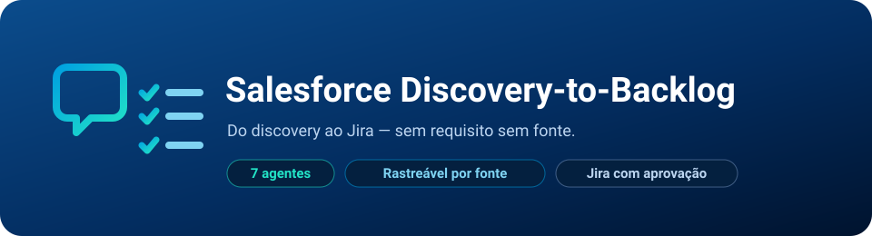

# Salesforce Discovery-to-Backlog

<p align="center">

  
</p>

<p align="center">
  
  
  
</p>


O **passo zero** do ciclo de skills Salesforce. Transforma as rodadas de discovery da PO (transcrições, resumos, requisitos estruturados ou não) em **backlog rastreável** — Epic › História › Subtarefa — para o atendimento de produtos financeiros no Service Cloud, publica no **Jira** só depois da aprovação explícita da PO e entrega o material para o negócio (**Word**, **PowerPoint** e um **protótipo clicável**). O resultado alimenta o **[Journey Designer](https://github.com/brunotrolo/Salesforce_Journey_Designer)**; depois vêm o [Journey Developer](https://github.com/brunotrolo/Salesforce_Journey_Developer) e o [Test Automator](https://github.com/brunotrolo/Salesforce_Test_Automator).

Instale no mesmo projeto do Designer: os dois compartilham `docs/sdd/` e `specs/`. A skill nunca desenha solução técnica e nunca escreve no Jira sem plano aprovado.

## Como funciona
Baseado no **Elephant–Goldfish Model** ([google/elephant-goldfish-model](https://github.com/google/elephant-goldfish-model), cópia literal em `.claude/skills/egm/`, só para consulta).
- **Elefante:** o `/sf-discover` na conversa principal guarda o contexto da PO, extrai e redige. **Goldfish:** revisores em contexto novo e somente leitura avaliam o backlog **contra as fontes**.
- **Sem fonte, sem requisito:** todo item carrega uma âncora (`S01:L120-134`) e uma citação conferida por código. O que a fonte não afirma vira **pergunta aberta**.
- **Decisão por código:** ingestão com PII mascarada, validação, plano de publicação, hook do Jira e handoff são scripts testados.

## Os 7 agentes

| Agente | Papel |
|---|---|
| `sf-disc-extractor` | Extrai de **um trecho** de uma fonte, em JSON, com citação literal e âncora. |
| `sf-disc-comprehension` | Leitor ingênuo: parafraseia o backlog sem conhecer o projeto e aponta o que não se entende. |
| `sf-disc-traceability` | Confere cada item contra as fontes: nada inventado, exagerado ou distorcido. |
| `sf-disc-story-quality` | INVEST, testabilidade do Dado/Quando/Então e Definition of Ready. |
| `sf-disc-domain-fit` | Service Cloud padrão-primeiro, LGPD e regulatório, aderência aos domínios do Designer. |
| `sf-disc-zoom-out` | Escopo, tamanho de épico, duplicidade, fatiamento de MVP e dependências. |
| `sf-disc-prototype-review` | Revisa o protótipo: fiel ao template, cenários percorríveis, nada inventado. |

## Pré-requisitos
- **Node.js ≥ 20**.
- **MCP do Jira** conectado, só para **publicar**. Sem ele, o backlog, o pacote de importação (`import-package.csv`) e os materiais da PO funcionam normalmente.
- `pip install python-docx python-pptx` para **Word** e **PowerPoint**; Playwright (opcional) para capturas do protótipo nesses arquivos.
- Para o handoff: o **Journey Designer** instalado (`docs/sdd/`).
- Material em `.txt`, `.md`, `.vtt`, `.srt`, `.csv`, `.json`, `.yaml` ou `.eml`; `.docx`, `.pdf`, `.pptx` e `.xlsx` são extraídos pelo host antes.

## Instalação

Dentro da pasta do **seu projeto**:

```bash
git clone --depth 1 https://github.com/brunotrolo/Salesforce_Discovery-to-Backlog.git .db-tmp
node .db-tmp/install.mjs
```

Depois apague a pasta temporária: `rm -rf .db-tmp` (Mac/Linux/Git Bash) ou `Remove-Item -Recurse -Force .db-tmp` (PowerShell).

O instalador funciona igual em Mac, Linux e Windows. Ele **copia** `.claude/` sem apagar nada seu, **mescla** o seu `.claude/settings.json` (hooks e permissões; guarda a cópia em `settings.json.anterior`) e acrescenta `discovery/`, `sources/`, `speakers.map.json` e `*.approved.json` ao `.gitignore` — material de discovery **nunca** vai para o git. Pode rodar de novo; `--dry-run` mostra o que faria.

**Para publicar no Jira**, preencha `.claude/skills/sf-discover/config/jira.config.json` (hoje provisório):

```json
{ "templates_status": "oficial", "project_key": "SEU_PROJETO" }
```

Enquanto estiver `provisorio` ou sem `project_key`, a publicação é **bloqueada** — o `import-package.csv` continua sendo gerado. Se o nome do servidor MCP do Jira não contiver "atlassian" nem "jira", acrescente `"mcp_server_pattern": "^mcp__seu-servidor__"`. As decisões que dependem da equipe estão em [`docs/open-decisions.md`](docs/open-decisions.md).

## Comandos

| Comando | O que faz |
|---|---|
| `/sf-discover <rodada> <fontes…>` | Ingestão, extração em paralelo, reconciliação com rodadas anteriores, rascunho com a PO, revisão Goldfish em 5 estágios e aprovação. Modos: `--consolidado` (sem portões), `--skip-review` (só com motivo registrado). |
| `/sf-po-pack <rodada>` | Entrevista de múltipla escolha → **Word**, **PowerPoint** e **protótipo HTML** derivado do template do console da equipe. |
| `/sf-backlog-publish <rodada>` | Plano (criar/atualizar/ignorar, com diff) → **aprovação da PO** → Jira. Nunca apaga, nunca muda status. |
| `/sf-discovery-status` | Situação de cada rodada e o próximo passo. |

O handoff ao Designer é `scripts/handoff-designer.mjs` (**dry-run por padrão**): histórias **aprovadas** e de domínio existente viram linhas em `docs/sdd/BACKLOG.md` e um `spec.md` semente só de negócio.

## Garantias (por código)
- **Jira:** o hook `guard-jira-write` nega exclusão, mudança de status, Confluence e outro projeto; escrita só com `publish_plan.approved.json` cujo hash bate, para um título ou chave do plano; payload ilegível é negado. *Limite:* o hook não prova que a PO aprovou de fato — por isso o `approve-plan.mjs` só roda após um "aprovo" explícito.
- **LGPD:** CPF/CNPJ/e-mail/telefone mascarados na entrada, falantes pseudonimizados, `discovery/` fora do git.
- **Protótipo:** parte sempre do template do console; o `check-prototype-html.mjs` reprova alteração fora do bloco da jornada, dado que pareça real e chamada de rede.

## Ciclo por rodada

```
material da PO → ingest (âncoras, PII mascarada) → extratores (≤ 6) → merge (citação literal conferida)
→ reconcile → rascunho Épico › História › Subtarefa com a PO → revisão Goldfish (estágios 5–9) → "aprovado"
→ /sf-po-pack (Word, PowerPoint, protótipo)   /sf-backlog-publish (Jira)   handoff-designer (BACKLOG.md + spec.md)
```

Detalhes (revisão em estágios, contrato do extrator, rodadas seguintes, entregas para o negócio, EGM): [`docs/como-funciona.md`](docs/como-funciona.md).

## O que NÃO foi verificado
O protótipo é uma réplica HTML do console, não o Salesforce real. Também não foram exercitados: o servidor e as ferramentas reais do MCP do Jira, os templates e campos reais do Jira, uma sessão real com a PO e os subagentes numa sessão real. Ver [`docs/open-decisions.md`](docs/open-decisions.md).

## Testes
`node scripts/verify-skills.mjs && node --test tests/*.test.mjs` — inclui os testes do instalador. Os de Word/PowerPoint exigem `python-docx` e `python-pptx`, e o do navegador exige Playwright; sem eles, são pulados.

---

## 📋 Resumo

| | |
|---|---|
| **Input** | Material das rodadas de discovery, em qualquer formato, e o `backlog.json` das rodadas anteriores. Para publicar: MCP do Jira e `jira.config.json`. |
| **O que faz** | Ingestão com âncoras → extração com citação conferida → rascunho com a PO → revisão Goldfish contra as fontes → aprovação → plano de publicação com aprovação explícita → Jira → handoff ao Designer. |
| **Entrega** | `discovery/<rodada>/backlog.json` (+ rascunho e CSV), Word, PowerPoint e protótipo para o negócio, itens no Jira e `spec.md` semente para o Designer. |

---

<p align="center">
  ⭐ <b><a href="https://github.com/brunotrolo/Salesforce_Discovery-to-Backlog/stargazers">Dê uma star no repo</a></b> para ser avisado das melhorias.
</p>
